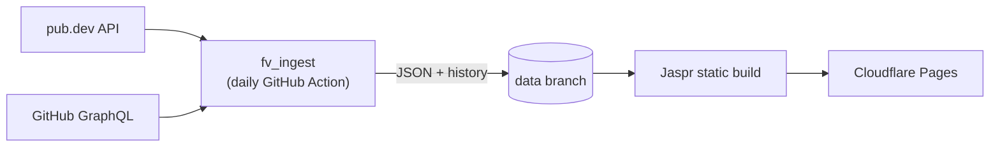

<div align="center">
  
  <h1><b>Flutterverse</b></h1>
  <p>
    The Flutter &amp; Dart ecosystem, measured daily: stars, pub.dev scores, momentum and a community Hall of Fame.
  </p>
  <p><a href="https://flutterverse.org"><b>flutterverse.org</b></a></p>
</div>

<p align="center">
  <a href="https://github.com/YeLwinOo-Steve/flutterverse/actions/workflows/ci.yml"></a>
  <a href="https://github.com/YeLwinOo-Steve/flutterverse/actions/workflows/ingest.yml"></a>
  <a href="https://dart.dev"></a>
  <a href="https://jaspr.site"></a>
  <a href="https://pages.cloudflare.com"></a>
  <a href="LICENSE"></a>
  <a href="CONTRIBUTING.md"></a>
</p>

| 📈 | 🚀 | 🏆 | 🗺️ |
|:---:|:---:|:---:|:---:|
| **Daily stats** | **Momentum** | **Hall of Fame** | **Roadmap** |
| GitHub stars, forks and issues plus pub.dev likes, points and downloads, refreshed every day | A 0–100 score for what's taking off right now, not just what's biggest | A yearly, editorially curated edition of standout projects and developers | A metro-map learning path through Dart and Flutter, with saved progress |


## Overview

- **Thousands of projects**: every Flutter Favorite, pub.dev's 3,000 most popular packages and every public Dart repo on GitHub with 100+ stars, discovered daily and sorted into categories by their topics; hand-picked entries in [`config/seeds.yaml`](config/seeds.yaml) refine them
- **Rankings and listings**: filter and sort by SDK, category, platform, stars, pub points and momentum
- **Project pages**: trend charts, release timeline, maintenance status and related projects
- **Flutter Favorites**: every package in pub.dev's Flutter Favorite program
- **Honest numbers**: when a source fails or history is too short, the site shows **N/A** rather than a made-up 0
- **$0 to run**: no servers, just GitHub Actions, a `data` branch and a static site


## How it works



1. A scheduled workflow runs **`fv_ingest`**, which discovers projects on pub.dev and GitHub (see `discovery:` in `config/seeds.yaml`), fetches their stats and scores every project.
2. It writes per-screen JSON plus a daily history line per project, and commits them to the **`data`** branch.
3. **`deploy-web`** pre-renders the [Jaspr](https://jaspr.site) site against that data and deploys it. Only the interactive pieces (tables, charts, the lamp) hydrate in the browser.

Models, metrics and formatting live in **`fv_core`**, shared by the ingest job and the site, so the two can never disagree on a number.


## Quick start

Requires **Dart 3.10+** (`.fvmrc` pins a Flutter SDK that ships it) and the Jaspr CLI.

```bash
dart pub global activate jaspr_cli
dart pub get                                    # once, at the root

# Fetch data into apps/web/web/data (history goes to .history/).
# GITHUB_TOKEN is optional; without it GitHub numbers are N/A.
GITHUB_TOKEN=$(gh auth token) dart run fv_ingest:ingest

cd apps/web && jaspr serve                      # http://localhost:8080
```

<details>
<summary><b>Checks</b> (the same ones CI runs)</summary>

```bash
dart analyze --fatal-infos
dart run tool/check_imports.dart
(cd packages/fv_core && dart test)
(cd packages/fv_ingest && dart test)
(cd apps/web && dart test)
dart run fv_ingest:validate_seeds --remote
```

</details>


## Metrics

<details>
<summary><b>Momentum</b>: how much a project is taking off right now (0–100)</summary>

A weighted sum of six signals, each scaled to 0–1 and compared against the other tracked projects:

| Weight | Signal |
|---:|---|
| 26% | 7-day stars, log-scaled against the fastest project |
| 24% | 30-day growth as a share of stars, capped at 12% |
| 16% | Acceleration: last week's pace vs the month's |
| 12% | Download growth over the quarter, capped at 25% |
| 12% | Recency of the last commit |
| 10% | Recency of the last release |

For a project with under a week of history, the week is estimated from the days there are and the score is shown as an early estimate, `~42`, until the week is complete. The exact definition is in [`momentum.dart`](packages/fv_core/lib/src/metrics/momentum.dart).

</details>

<details>
<summary><b>Maintenance</b>: Active, Slowing or Low activity</summary>

- **Active**: committed within 30 days and released within 120
- **Slowing**: any activity within 120 days
- **Low activity**: neither

</details>

Star growth needs history, because GitHub only reports current counts (and no longer exposes stargazer dates), so trend numbers fill in as the daily history builds up.


## Project structure

```
config/
  seeds.yaml          discovery settings, curated projects, categories, Hall of Fame (hand-edited)
  roadmap.json        learning roadmap content (hand-edited)
packages/
  fv_core/            models, metrics, formatters (pure Dart, compiles to the web)
  fv_ingest/          CLI: fetch → normalise → score → write JSON; nomination triage
apps/
  web/                Jaspr static site
    lib/components/   shared UI: ui/ primitives, layout/ site chrome, project/ displays
    lib/pages/<page>/ one folder per page, one small component per file
    lib/styles/       design tokens (light/dark), shared classes
tool/                 check_imports.dart enforces the package dependency rules
.github/workflows/    ci, ingest (daily), deploy-web, nominations
```

<details>
<summary><b>Generated data</b></summary>

| File | Contents |
|---|---|
| `index.json` | Slim rows for the listing and rankings tables |
| `p/<id>.json` | Full detail and up to 90 days of history |
| `pub.json` | Every Flutter Favorite |
| `hof.json` | The Hall of Fame edition, with developers' GitHub stats |
| `roadmap.json` | The learning roadmap |
| `meta.json` | `generatedAt` and the schema version |
| `history/<id>.ndjson` | One line of raw counters per project per day |

</details>


## Contributing

- **Add a project:** popular ones are found automatically. For anything else, or to fix a name or category, send a one-file PR to [`config/seeds.yaml`](config/seeds.yaml). CI checks the package and repo exist.
- **Nominate for the Hall of Fame:** use the **Propose** buttons on the site, or the issue forms. Nominations are checked automatically, then reviewed by the editorial team.
- **Work on the code:** follow [GUIDELINES.md](GUIDELINES.md). Small components, `fv_core` for shared logic, `null` for missing data.

See [CONTRIBUTING.md](CONTRIBUTING.md) for the details.


## Deployment

1. Push to GitHub (a public repo keeps Actions minutes free).
2. Create a Cloudflare Pages project named `flutterverse` (direct upload).
3. Add repository secrets `CF_API_TOKEN` (Pages: Edit) and `CF_ACCOUNT_ID`.
4. Run the **ingest** workflow once by hand. It creates the `data` branch, and a successful run triggers **deploy-web**.

> [!NOTE]
> GitHub disables scheduled workflows after 60 days without repository activity. If that happens, re-enable **ingest** from the Actions tab.


## License

MIT. See [LICENSE](LICENSE).
